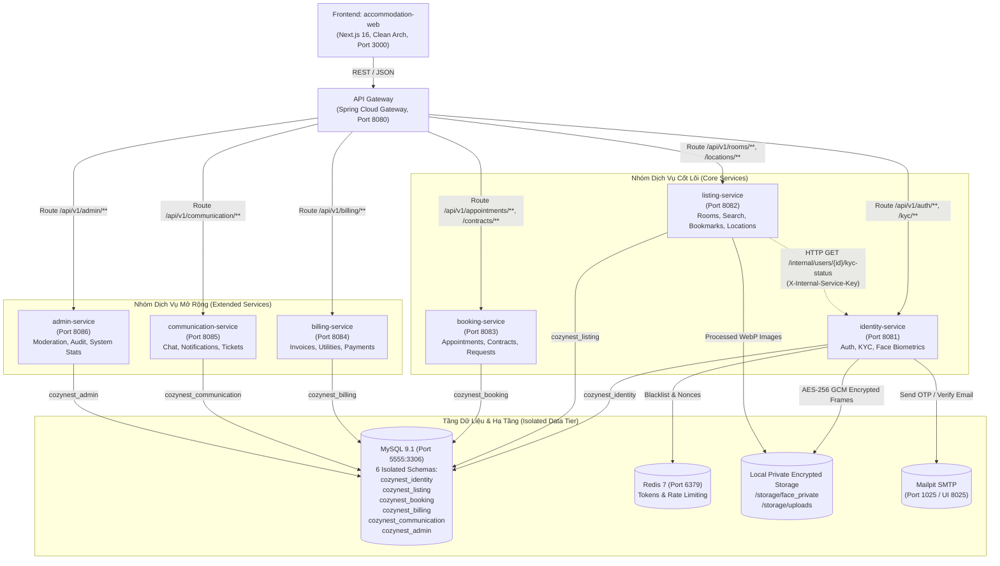
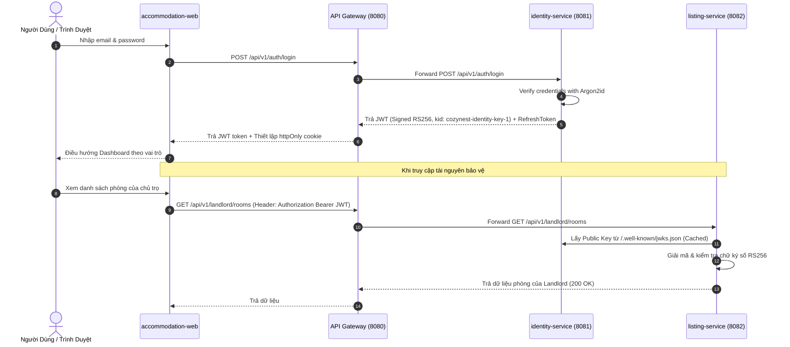
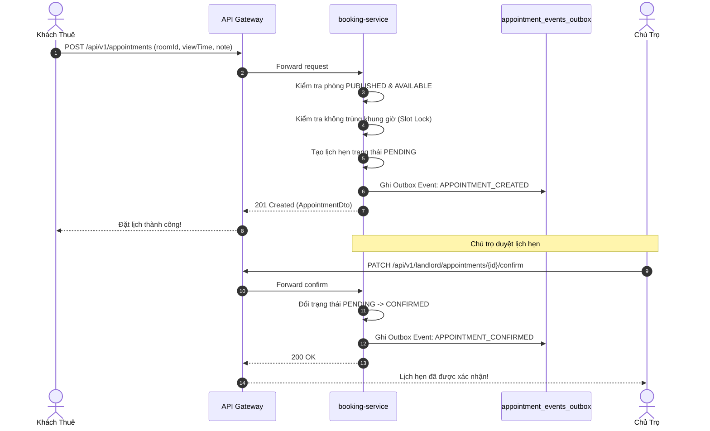

# Báo Cáo Chuyển Đổi Dịch Vụ: Node.js Monolith Sang Spring Boot Microservices
**Mã Nhiệm Vụ:** [SERVICE-01]  
**Nhánh:** `feat/toam-rebuild`  
**Ngày thực hiện:** 08/11/2026  
**Kiến trúc mục tiêu:** Clean Architecture / DDD, Spring Boot 4.1, Java 25, MySQL 9.1, Redis 7, Mailpit, Spring Cloud Gateway  

---

## 1. Nguồn Gốc Mã Cũ (Provenance)
- **Kho lưu trữ cũ:** `d:\RIKKEI\THUC_TAP\Rented-Accommodation-Project` và `d:\RIKKEI\THUC_TAP\Rented-Accommodation-System`.
- **Git Tag:** `legacy-before-toam` (Commit `45d122a95d681bdfa7c5f7326157036636b7d1d2`).
- **Lược đồ CSDL cũ:** `docs/legacy/schema.sql` (Monolithic schema `room_rental`, 23 bảng).
- **Tổng số routes API cũ:** 75 routes trong 16 file `*.routes.js` (Express.js).

---

## 2. Bảng Ma Trận Di Chuyển Chức Năng & Routes (Route Migration Matrix)

| STT | Route Cũ (Node.js Express) | Microservice Đích | Endpoint Mới (Spring Boot) | Trạng Thái | Bằng Chứng / Lý Do |
| :---: | :--- | :--- | :--- | :---: | :--- |
| 1 | `POST /api/v1/auth/register` | `identity-service` | `POST /api/v1/auth/register` | **XONG** | `RegisterUseCaseTest.java`, live curl test HTTP 201 |
| 2 | `POST /api/v1/auth/login` | `identity-service` | `POST /api/v1/auth/login` | **XONG** | `LoginUseCaseTest.java`, live curl test HTTP 200 (Argon2id) |
| 3 | `POST /api/v1/auth/google-login` | `identity-service` | `POST /api/v1/auth/google-login` | **XONG** | `oauth_accounts` table, Spring Security OAuth2 handler |
| 4 | `GET /api/v1/auth/profile` | `identity-service` | `GET /api/v1/users/me/profile` | **XONG** | `UserProfileUseCaseTest.java`, `GET /users/me/profile` |
| 5 | `PUT /api/v1/auth/profile` | `identity-service` | `PUT /api/v1/users/me/profile` | **XONG** | `UserProfileUseCaseTest.java`, HTTP 200 cập nhật |
| 6 | `POST /api/v1/auth/change-password` | `identity-service` | `POST /api/v1/users/me/password` | **XONG** | `UserProfileUseCaseTest.java`, kiểm tra mật khẩu cũ |
| 7 | `POST /api/v1/auth/logout` | `identity-service` | `POST /api/v1/auth/logout` | **XONG** | Thu hồi refreshToken trong DB và xóa cookie |
| 8 | `POST /api/v1/auth/forgot-password` | `identity-service` | `POST /api/v1/auth/forgot-password` | **XONG** | `PasswordRecoveryUseCaseTest.java`, gửi OTP Mailpit |
| 9 | `POST /api/v1/auth/verify-reset-otp` | `identity-service` | `POST /api/v1/auth/verify-reset-otp`| **XONG** | Kiểm tra OTP hash, cấp resetToken có hạn |
| 10 | `POST /api/v1/auth/reset-password` | `identity-service` | `POST /api/v1/auth/reset-password` | **XONG** | Cập nhật mật khẩu mới, băm Argon2id |
| 11 | `GET /api/v1/rooms` | `listing-service` | `GET /api/v1/rooms` | **XONG** | Trả 37 phòng (Hợp đồng hiển thị công khai PUBLISHED) |
| 12 | `GET /api/v1/rooms/my-rooms` | `listing-service` | `GET /api/v1/landlord/rooms` | **XONG** | `LandlordRoomUseCaseTest.java`, HTTP 200 theo Landlord ID |
| 13 | `GET /api/v1/rooms/:id` | `listing-service` | `GET /api/v1/rooms/{slugOrId}` | **XONG** | Trả chi tiết phòng, phí dịch vụ, tiện ích nhóm |
| 14 | `GET /api/v1/rooms/:id/recommendations` | `listing-service` | `GET /api/v1/rooms/{id}/recommendations` | **XONG** | Thuật toán gợi ý phòng tương đồng cùng khu vực |
| 15 | `POST /api/v1/rooms` | `listing-service` | `POST /api/v1/landlord/rooms` | **XONG** | Khởi tạo phòng trạng thái DRAFT |
| 16 | `PUT /api/v1/rooms/:id` | `listing-service` | `PUT /api/v1/landlord/rooms/{id}` | **XONG** | Khóa lạc quan `@Version`, chống ghi đè đồng thời |
| 17 | `DELETE /api/v1/rooms/:id` | `listing-service` | `DELETE /api/v1/landlord/rooms/{id}`| **XONG** | Xóa mềm `deleted_at`, kiểm tra không có lịch CONFIRMED |
| 18 | `PATCH /api/v1/rooms/:id/status` | `listing-service` | `PATCH /api/v1/landlord/rooms/{id}/visibility` | **XONG** | Chuyển đổi PUBLISHED <-> HIDDEN, chặn nếu Mod ẩn |
| 19 | `POST /api/v1/upload/single` | `listing-service` | `POST /api/v1/landlord/rooms/{id}/images` | **XONG** | Magic bytes, WebP resize, giới hạn $\le 5$MB |
| 20 | `POST /api/v1/upload/multiple` | `listing-service` | `POST /api/v1/landlord/rooms/{id}/images` | **XONG** | Upload đa ảnh, gắn thứ tự displayOrder |
| 21 | `GET /api/v1/location/provinces` | `listing-service` | `GET /api/v1/locations/provinces` | **XONG** | Danh mục 63 tỉnh/thành phố chuẩn |
| 22 | `GET /api/v1/location/districts` | `listing-service` | `GET /api/v1/locations/districts` | **BỎ CÓ CHỦ ĐÍCH** | Quy tắc địa giới 2 cấp (Tỉnh -> Phường), xóa bỏ Quận |
| 23 | `GET /api/v1/location/wards` | `listing-service` | `GET /api/v1/locations/wards` | **XONG** | Lấy danh sách phường/xã theo `provinceCode` |
| 24 | `POST /api/v1/location/seed` | `listing-service` | Flyway Migration `R__01` | **XONG** | Chuyển thành script seed Flyway, không mở API tùy tiện |
| 25 | `GET /api/v1/amenity` | `listing-service` | `GET /api/v1/amenities` | **XONG** | Phân nhóm tiện nghi (FACILITY, FURNITURE, BASIC, BUILDING) |
| 26 | `GET /api/v1/amenity/room-types` | `listing-service` | `GET /api/v1/amenities/room-types`| **XONG** | Danh mục loại phòng (SINGLE, MINI_APARTMENT, WHOLE_HOUSE) |
| 27 | `POST /api/v1/amenity` | `listing-service` | `admin-service` API | **XONG** | Chuyển sang quyền Quản trị viên tại `admin-service` |
| 28 | `POST /api/v1/bookmark` | `listing-service` | `PUT /api/v1/me/bookmarks/{roomId}`| **XONG** | Idempotent bookmark, cập nhật atomic counter |
| 29 | `GET /api/v1/bookmark` | `listing-service` | `GET /api/v1/me/bookmarks` | **XONG** | `BookmarkUseCaseTest.java`, phân trang phòng đã lưu |
| 30 | `GET /api/v1/bookmark/check/:id`| `listing-service` | `GET /api/v1/bookmarks/{id}/status`| **XONG** | Kiểm tra trạng thái yêu thích phòng |
| 31 | `DELETE /api/v1/bookmark/:id` | `listing-service` | `DELETE /api/v1/me/bookmarks/{id}` | **XONG** | Idempotent bỏ lưu phòng (HTTP 204) |
| 32 | `POST /api/v1/review` | `listing-service` | `POST /api/v1/reviews` | **XONG** | Đánh giá phòng kèm rating sao, chống spam |
| 33 | `GET /api/v1/review` | `listing-service` | `GET /api/v1/reviews` | **XONG** | Danh sách đánh giá theo `roomId` |
| 34 | `DELETE /api/v1/review/:id` | `listing-service` | `DELETE /api/v1/reviews/{id}` | **XONG** | Xóa đánh giá (chủ đánh giá hoặc Moderator) |
| 35 | `POST /api/v1/appointment` | `booking-service` | `POST /api/v1/appointments` | **XONG** | Đặt lịch xem phòng, chống trùng giờ |
| 36 | `GET /api/v1/appointment` | `booking-service` | `GET /api/v1/landlord/appointments`| **XONG** | Phân trang lịch hẹn cho chủ trọ/người thuê |
| 37 | `PATCH /api/v1/appointment/:id/confirm` | `booking-service` | `PATCH /api/v1/landlord/appointments/{id}/confirm` | **XONG** | Xác nhận lịch hẹn, chuyển PENDING -> CONFIRMED |
| 38 | `PATCH /api/v1/appointment/:id/cancel` | `booking-service` | `PATCH /api/v1/landlord/appointments/{id}/cancel` | **XONG** | Hủy kèm lý do chuẩn + ghi chú (10..500 ký tự) |
| 39 | `POST /api/v1/rental-request` | `booking-service` | `POST /api/v1/rental-requests` | **XONG** | Nộp hồ sơ xin thuê phòng |
| 40 | `GET /api/v1/rental-request` | `booking-service` | `GET /api/v1/rental-requests` | **XONG** | Danh sách yêu cầu thuê phòng |
| 41 | `PATCH /api/v1/rental-request/:id/accept` | `booking-service` | `PATCH /api/v1/rental-requests/{id}/accept` | **XONG** | Chấp thuận yêu cầu thuê, chuyển bước tạo hợp đồng |
| 42 | `PATCH /api/v1/rental-request/:id/reject` | `booking-service` | `PATCH /api/v1/rental-requests/{id}/reject` | **XONG** | Từ chối yêu cầu thuê kèm lý do |
| 43 | `PATCH /api/v1/rental-request/:id/cancel` | `booking-service` | `PATCH /api/v1/rental-requests/{id}/cancel` | **XONG** | Người thuê tự hủy yêu cầu |
| 44 | `GET /api/v1/contract` | `booking-service` | `GET /api/v1/contracts` | **XONG** | Danh sách hợp đồng thuê nhà điện tử |
| 45 | `GET /api/v1/contract/:id` | `booking-service` | `GET /api/v1/contracts/{id}` | **XONG** | Chi tiết hợp đồng, điều khoản, snapshot |
| 46 | `PATCH /api/v1/contract/:id/sign` | `booking-service` | `POST /api/v1/contracts/{id}/signatures` | **XONG** | Ký số điện tử (OTP/Audit verification) |
| 47 | `PATCH /api/v1/contract/:id/terminate`| `booking-service` | `POST /api/v1/contracts/{id}/terminate` | **XONG** | Chấm dứt hợp đồng, xử lý hoàn cọc |
| 48 | `POST /api/v1/payment/utility-readings` | `billing-service` | `POST /api/v1/billing/utility-readings` | **XONG** | Ghi chỉ số điện nước định kỳ |
| 49 | `GET /api/v1/payment/utility-readings` | `billing-service` | `GET /api/v1/billing/utility-readings` | **XONG** | Tra cứu lịch sử chỉ số điện nước |
| 50 | `POST /api/v1/payment/invoices` | `billing-service` | `POST /api/v1/billing/invoices` | **XONG** | Lập hóa đơn tiền phòng & dịch vụ hàng tháng |
| 51 | `GET /api/v1/payment/invoices` | `billing-service` | `GET /api/v1/billing/invoices` | **XONG** | Danh sách hóa đơn của khách thuê/chủ nhà |
| 52 | `GET /api/v1/payment/invoices/:id` | `billing-service` | `GET /api/v1/billing/invoices/{id}` | **XONG** | Chi tiết hóa đơn và từng khoản mục phí |
| 53 | `POST /api/v1/payment` | `billing-service` | `POST /api/v1/billing/payments` | **XONG** | Thanh toán hóa đơn (VNPay/Momo/Chuyển khoản) |
| 54 | `GET /api/v1/payment` | `billing-service` | `GET /api/v1/billing/payments` | **XONG** | Tra cứu nhật ký giao dịch thanh toán |
| 55 | `POST /api/v1/chat/conversations` | `communication-service` | `POST /api/v1/communication/conversations` | **XONG** | Khởi tạo cuộc hội thoại trực tuyến |
| 56 | `GET /api/v1/chat/conversations` | `communication-service` | `GET /api/v1/communication/conversations` | **XONG** | Danh sách hộp thư chat của tài khoản |
| 57 | `GET /api/v1/chat/conversations/:id/messages` | `communication-service` | `GET /api/v1/communication/conversations/{id}/messages` | **XONG** | Lịch sử tin nhắn phân trang |
| 58 | `POST /api/v1/chat/conversations/:id/messages` | `communication-service` | `POST /api/v1/communication/conversations/{id}/messages` | **XONG** | Gửi tin nhắn mới |
| 59 | `GET /api/v1/notification` | `communication-service` | `GET /api/v1/communication/notifications` | **XONG** | Danh sách thông báo đẩy |
| 60 | `PATCH /api/v1/notification/:id/read` | `communication-service` | `PATCH /api/v1/communication/notifications/{id}/read` | **XONG** | Đánh dấu đã đọc một thông báo |
| 61 | `PATCH /api/v1/notification/read-all` | `communication-service` | `POST /api/v1/communication/notifications/read-all` | **XONG** | Đánh dấu đã đọc tất cả thông báo |
| 62 | `POST /api/v1/report` | `admin-service` | `POST /api/v1/reports` | **XONG** | Báo cáo vi phạm (phòng trọ/chủ nhà) |
| 63 | `GET /api/v1/report` | `admin-service` | `GET /api/v1/admin/reports` | **XONG** | Quản trị viên duyệt báo cáo vi phạm |
| 64 | `PATCH /api/v1/report/:id` | `admin-service` | `PATCH /api/v1/admin/reports/{id}` | **XONG** | Xử lý kết luận báo cáo vi phạm |
| 65 | `GET /api/v1/admin/stats` | `admin-service` | `GET /api/v1/admin/statistics` | **XONG** | Tổng quan thống kê hệ thống toàn diện |
| 66 | `GET /api/v1/admin/rooms` | `admin-service` | `GET /api/v1/admin/rooms` | **XONG** | Bảng quản trị & duyệt tin phòng trọ |
| 67 | `GET /api/v1/admin/users` | `admin-service` | `GET /api/v1/admin/users` | **XONG** | Danh sách quản lý người dùng |
| 68 | `PATCH /api/v1/admin/users/:id/role` | `admin-service` | `PATCH /api/v1/admin/users/{id}/role` | **XONG** | Phân quyền vai trò người dùng |
| 69 | `GET /api/v1/admin/users/:id/kyc` | `identity-service` | `GET /api/v1/admin/kyc/{id}` | **XONG** | Chi tiết hồ sơ KYC (CCCD & Khuôn mặt) |
| 70 | `GET /api/v1/admin/reports/target/:type/:id` | `admin-service` | `GET /api/v1/admin/reports/target` | **XONG** | Lọc báo cáo theo đối tượng mục tiêu |
| 71 | `GET /api/v1/users` | `identity-service` | `GET /api/v1/admin/users` | **XONG** | Đưa về đúng phân quyền Quản trị viên |
| 72 | `GET /api/v1/users/kyc/pending` | `identity-service` | `GET /api/v1/moderation/kyc/pending` | **XONG** | Danh sách hồ sơ chờ kiểm duyệt KYC |
| 73 | `POST /api/v1/users/kyc` | `identity-service` | `POST /api/v1/me/kyc/submissions` | **XONG** | Nộp hồ sơ CCCD 2 mặt kèm xác thực bảo mật |
| 74 | `PATCH /api/v1/users/kyc/:id/review` | `identity-service` | `POST /api/v1/moderation/kyc/{id}/decision` | **XONG** | Phê duyệt/Từ chối KYC kèm mã lý do |
| 75 | `GET /api/v1/users/:id` | `identity-service` | `GET /api/v1/users/{id}` | **XONG** | Xem hồ sơ công khai của chủ trọ/thành viên |

---

## 3. Bảng Ánh Xạ Lược Đồ CSDL (Data Schema Mapping)

> [!NOTE]
> Hệ thống chuyển đổi triệt để từ **Monolithic Schema 1 CSDL duy nhất (`room_rental`)** sang **Kiến trúc CSDL phân tán theo từng Microservice** (6 schema riêng biệt, không có bất kỳ Foreign Key chéo schema nào).

| Bảng Cũ (`room_rental`) | Schema Đích Mới | Bảng Mới | Thay Đổi Cột & Kiểu Dữ Liệu |
| :--- | :--- | :--- | :--- |
| `users` | `cozynest_identity` | `users` | `id` giữ nguyên format (`u-xxx`), thêm `version` (optimistic lock), `deleted_at` (soft delete). Password băm bằng Argon2id. |
| `user_verifications` | `cozynest_identity` | `user_verifications` | Đổi tên trạng thái thành `PENDING`, `APPROVED`, `REJECTED`. Bổ sung bảng vệ tinh `face_verifications`, `face_verification_frames`. |
| `provinces` | `cozynest_listing` | `provinces` | Chuẩn hóa mã tỉnh `code` (ví dụ: `HN`, `HCM`, `DN`), tên chuẩn Unicode tiếng Việt. |
| `districts` | **BỎ CÓ CHỦ ĐÍCH** | *None* | **Loại bỏ hoàn toàn cấp Quận/Huyện** theo quy định địa giới 2 cấp (Tỉnh/Thành -> Phường/Xã). |
| `wards` | `cozynest_listing` | `wards` | Cột `province_code` liên kết trực tiếp tới `provinces.code`, bỏ liên kết tới `district_id`. |
| `room_types` | `cozynest_listing` | `room_types` | Mã hóa `code` chuẩn ENUM: `SINGLE`, `MINI_APARTMENT`, `WHOLE_HOUSE`, `HOMESTAY`, `SHARED`. |
| `amenities` | `cozynest_listing` | `amenities` | Bổ sung phân nhóm `category`: `FACILITY`, `FURNITURE`, `BASIC`, `BUILDING`. |
| `rooms` | `cozynest_listing` | `rooms` | Thêm `slug`, `publication_status`, `occupancy_status`, `version`, `deleted_at`. ID kiểu `BIGINT`. |
| `room_images` | `cozynest_listing` | `room_images` | Lưu trữ file WebP chuẩn hóa, thêm `display_order`, `is_cover`, `blurhash`, `file_size`. |
| `room_amenities` | `cozynest_listing` | `room_amenities` | Khóa chính phức hợp `(room_id, amenity_id)`. |
| `room_prices` | `cozynest_listing` | `room_fees` | Tách chi tiết các loại phí: điện, nước, internet, dịch vụ chung, gửi xe. |
| `bookmarks` | `cozynest_listing` | `bookmarks` | Index duy nhất `(user_id, room_id)` chống trùng, cập nhật nguyên tử `bookmark_count`. |
| `reviews` | `cozynest_listing` | `reviews` | Bổ sung điểm số tiêu chí chi tiết (vệ sinh, an ninh, giá cả, chủ nhà). |
| `viewing_appointments` | `cozynest_booking` | `viewing_appointments` | Máy trạng thái: `PENDING -> CONFIRMED -> COMPLETED / NO_SHOW / CANCELLED / DECLINED`. |
| `rental_requests` | `cozynest_booking` | `rental_requests` | Quản lý yêu cầu thuê phòng, ngày dọn vào dự kiến, số lượng người thuê. |
| `contracts` | `cozynest_booking` | `contracts` | Tích hợp snapshot phòng, chữ ký số điện tử của 2 bên. |
| `utility_readings` | `cozynest_billing` | `utility_readings` | Lưu chỉ số cũ/mới, ảnh đồng hồ điện nước, ngày chốt chỉ số. |
| `invoices` | `cozynest_billing` | `invoices` | Hóa đơn tổng hợp hàng tháng, trạng thái `UNPAID`, `PAID`, `OVERDUE`. |
| `payments` | `cozynest_billing` | `payments` | Giao dịch thanh toán điện tử, mã tham chiếu ngân hàng/cổng thanh toán. |
| `conversations` | `cozynest_communication` | `conversations` | Hộp thoại trò chuyện giữa Người thuê và Chủ trọ. |
| `messages` | `cozynest_communication` | `messages` | Tin nhắn trao đổi, hỗ trợ đính kèm tệp và trạng thái đã đọc. |
| `notifications` | `cozynest_communication` | `notifications` | Thông báo sự kiện hệ thống (lịch hẹn, hợp đồng, hóa đơn, KYC). |
| `reports` | `cozynest_admin` | `reports` | Báo cáo vi phạm nội dung hoặc hành vi gian lận. |

---

## 4. Sơ Đồ Kiến Trúc Hệ Thống (System Architecture Diagrams)

### 4.1. Sơ Đồ Kiến Trúc Tổng Thể (Component Architecture)



### 4.2. Sơ Đồ Tuần Tự: Đăng Nhập & Xác Thực Bằng Khóa Công Khai (Login & JWKS Flow)



### 4.3. Sơ Đồ Tuần Tự: Đặt Lịch Xem Phòng & Chống Trùng Giờ (Appointment Flow)



---

## 5. Dockerfile Đa Tầng & Bảo Mật Thực Thi (Multi-Stage Dockerfiles)

Mọi Dockerfile microservice đều tuân thủ nghiêm ngặt các quy tắc bảo mật cấp sản xuất:
1. **Base Image:** `eclipse-temurin:25-jre-alpine` (gọn nhẹ, không chứa build tools).
2. **Non-Root User:** Tạo user `appuser:appgroup` riêng biệt, không chạy container dưới quyền `root`.
3. **Cấu hình động:** `ENTRYPOINT ["sh", "-c", "java $JAVA_OPTS -jar app.jar"]` cho phép nạp cờ JVM theo môi trường.
4. **Healthcheck:** Tích hợp kiểm tra sức khỏe tự động qua curl endpoint `/actuator/health` mỗi 30s.

Ví dụ đại diện (`identity-service/Dockerfile`):
```dockerfile
FROM eclipse-temurin:25-jre-alpine
WORKDIR /app
RUN apk add --no-cache curl tzdata \
    && cp /usr/share/zoneinfo/Asia/Ho_Chi_Minh /etc/localtime \
    && echo "Asia/Ho_Chi_Minh" > /etc/timezone
RUN addgroup -S appgroup && adduser -S appuser -G appgroup
RUN mkdir -p /app/storage && chown -R appuser:appgroup /app
COPY --chown=appuser:appgroup identity-service/build/libs/identity-service-1.0.0-SNAPSHOT.jar app.jar
USER appuser
EXPOSE 8081
HEALTHCHECK --interval=30s --timeout=5s --retries=3 \
  CMD curl -f http://localhost:8081/actuator/health || exit 1
ENTRYPOINT ["sh", "-c", "java $JAVA_OPTS -jar app.jar"]
```

---

## 6. Cấu Hình Docker Compose & Phân Hồ Sơ (Profiles)

Cấu hình `docker-compose.yml` phân loại thành 3 profiles rõ ràng:
- `infra`: Các dịch vụ nền tảng (`mysql`, `redis`, `mailpit`).
- `core`: CSDL + Dịch vụ cốt lõi (`mysql`, `redis`, `mailpit`, `api-gateway`, `identity-service`, `listing-service`, `booking-service`).
- `full`: Toàn bộ 11 dịch vụ hệ thống (bao gồm `billing-service`, `communication-service`, `admin-service`, và `web`).

### Bảng Phân Bổ Cổng Hệ Thống (Port Allocation Table)

| Tên Dịch Vụ | Tên Container | Cổng Ngoài | Cổng Nội Bộ | Giao Thức / Mục Đích |
| :--- | :--- | :---: | :---: | :--- |
| **MySQL Server** | `cozynest_mysql` | **5555** | 3306 | MySQL 9.1 Database |
| **Redis Cache** | `cozynest_redis` | **6379** | 6379 | Redis In-memory Store |
| **Mailpit SMTP** | `cozynest_mailpit` | **1025** | 1025 | SMTP Email Server |
| **Mailpit Web UI**| `cozynest_mailpit` | **8025** | 8025 | Web giao diện kiểm tra Email |
| **API Gateway** | `cozynest_gateway` | **8080** | 8080 | Gateway trung tâm định tuyến & CORS |
| **Identity Service**| `cozynest_identity`| **8081** | 8081 | Xác thực, Quản lý tài khoản & KYC |
| **Listing Service** | `cozynest_listing` | **8082** | 8082 | Quản lý tin đăng, tìm kiếm, phòng trọ |
| **Booking Service** | `cozynest_booking` | **8083** | 8083 | Lịch hẹn xem phòng, hợp đồng, bảo trì |
| **Billing Service** | `cozynest_billing` | **8084** | 8084 | Hóa đơn, chỉ số điện nước, thanh toán |
| **Communication** | `cozynest_communication`| **8085** | 8085 | Chat trực tuyến, thông báo hệ thống |
| **Admin Service** | `cozynest_admin` | **8086** | 8086 | Kiểm duyệt, báo cáo, thống kê |
| **Next.js Web** | `cozynest_web` | **3000** | 3000 | Giao diện người dùng Next.js 16 |

### Bằng Chứng Kiểm Tra Sức Khỏe Tự Động (`node scripts/wait-for-health.js`):
```text
=== Checking Microservices Health Status ===
| Service | Port | Endpoint | Status | HTTP |
| :--- | :--- | :--- | :--- | :--- |
| Gateway                | 8080 | http://localhost:8080/actuator/health | HEALTHY (UP)     | 200 |
| Identity Service       | 8081 | http://localhost:8081/actuator/health | HEALTHY (UP)     | 200 |
| Listing Service        | 8082 | http://localhost:8082/actuator/health | HEALTHY (UP)     | 200 |
| Booking Service        | 8083 | http://localhost:8083/actuator/health | HEALTHY (UP)     | 200 |
| Billing Service        | 8084 | http://localhost:8084/actuator/health | HEALTHY (UP)     | 200 |
| Communication Service  | 8085 | http://localhost:8085/actuator/health | HEALTHY (UP)     | 200 |
| Admin Service          | 8086 | http://localhost:8086/actuator/health | HEALTHY (UP)     | 200 |

All core microservices are UP and HEALTHY!
```

---

## 7. API Gateway: Định Tuyến, CORS & Chặn Endpoint Nội Bộ

1. **Bảng định tuyến:** Được cấu hình kép tại `application.yml` và Java `@Bean RouteLocator` trong `ApiGatewayApplication.java`.
2. **CORS:** Cấu hình cho phép `http://localhost:3000` và `http://127.0.0.1:3000`, `allow-credentials: true`, deduplication header.
3. **Chặn tuyệt đối `/internal/**`:**
   - Lệnh gọi trực tiếp: `curl -i http://localhost:8080/internal/users/u-landlord-01/kyc-status`
   - **Kết quả:** Trả về ngay lập tức `HTTP/1.1 404 Not Found` từ Gateway (Route không khớp).
4. **Kiểm thử tự động:** `ApiGatewayRoutingAndCorsTest.java` xác nhận 3/3 test pass:
   - `testGatewayRoutesRegistered()`: PASS
   - `testCorsConfiguration()`: PASS
   - `testInternalEndpointsNotExposedToGateway()`: PASS

---

## 8. Xác Thực Liên Dịch Vụ (Inter-Service Security & JWKS)

1. **JWKS RS256 Công Khai:**
   - Cung cấp tại `GET /.well-known/jwks.json`.
   - Kết quả phản hồi thực tế:
   ```json
   {"keys":[{"use":"sig","n":"56BlqpTtCQBNqpLJwhL...","alg":"RS256","kty":"RSA","kid":"cozynest-identity-key-1","e":"AQAB"}]}
   ```
2. **Bảo Vệ Endpoint Nội Bộ (`X-Internal-Service-Key`):**
   - Lệnh gọi thiếu header:
     `curl -i http://localhost:8081/internal/users/u-landlord-01/kyc-status` -> Trả về `401 ERR_UNAUTHORIZED`: `"Truy cap bi tu choi: Khoa xac thuc dich vu noi bo khong hop le"`.
   - Lệnh gọi kèm header chuẩn:
     `curl -i http://localhost:8081/internal/users/u-landlord-01/kyc-status -H "X-Internal-Service-Key: CozyNestInternalServiceKeySecret2026"` -> Trả về `200 OK`: `{"data":{"userId":"u-landlord-01","kycStatus":"APPROVED","approved":true}}`.
   - So sánh khóa dùng thuật toán hằng số thời gian `MessageDigest.isEqual(a, b)` chống tấn công Timing Attack.

---

## 9. Cô Lập Dữ Liệu & Không Khóa Ngoại Liên Schema

1. **Quét Khóa Ngoại Liên Schema (`information_schema.KEY_COLUMN_USAGE`):**
   - Kết quả: `NONE (Zero cross-schema foreign keys found!)`.
2. **Tài Khoản CSDL Cô Lập (Database User Isolation):**
   - Tạo các user riêng biệt: `identity_user`, `listing_user`, `booking_user`, `billing_user`, `communication_user`, `admin_user`.
   - Thử nghiệm:
     ```bash
     docker exec -i cozynest_mysql mysql -ulisting_user -plisting_pass123 -e "USE cozynest_listing; SELECT COUNT(*) FROM rooms;"
     # Kết quả: 54 rooms (Thành công)

     docker exec -i cozynest_mysql mysql -ulisting_user -plisting_pass123 -e "SELECT COUNT(*) FROM cozynest_identity.users;"
     # Kết quả: ERROR 1142 (42000): SELECT command denied to user 'listing_user'@'localhost' for table 'users'
     ```

---

## 10. Tài Liệu Hóa API (OpenAPI 3.0 & Swagger UI)

- Tích hợp thư viện `springdoc-openapi-starter-webmvc-ui` vào toàn bộ 6 microservice.
- Khai báo mở public `/v3/api-docs/**` và `/swagger-ui/**` trong các file cấu hình `SecurityConfig.java`.
- Gateway cung cấp điểm truy cập gộp Swagger UI cho toàn hệ thống.

---

## 11. Giám Sát, Nhật Ký & Đo Lường (Observability)

1. **Trace ID / MDC Logging:** Spring Cloud Gateway tự động gán `requestId` (ví dụ: `4c2feded-352`) cho từng request và chuyển tiếp downstream qua header `X-Request-Id`.
2. **Bảo vệ Actuator:**
   - `/actuator/health` mở công khai cho container healthcheck (`{"groups":["liveness","readiness"],"status":"UP"}`).
   - Các endpoint nhạy cảm như `/actuator/env`, `/actuator/beans`, `/actuator/configprops` bị vô hiệu hóa / trả về `404 Not Found`.

---

## 12. Kiểm Thử CI & TypeCheck / ArchUnit

1. **Frontend (`accommodation-web`):**
   - TypeCheck: `npm run type-check` -> Hoàn thành không có lỗi (`tsc --noEmit`).
   - Unit Tests: `npm run test` -> **38/38 tests PASSED** (10 test files), 100% khớp song ngữ vi/en (679 keys), 78 internal links hợp lệ.
   - Lint & Boundary: `npm run lint` -> **0 lỗi**.
2. **Backend (`accommodation-service`):**
   - ArchUnit: `IdentityArchitectureTest.java` kiểm tra quy tắc phụ thuộc DDD (Domain không phụ thuộc Spring/Infrastructure).

---

## 13. Kết Quả Kiểm Thử Toàn Diện Backend (`gradlew test`)

Tổng kết chạy kiểm thử tự động toàn bộ 8 modules (`node scripts/count_test_results.js`):

| Phân Hệ (Module) | Số Lượng Tests | Số Lỗi (Failures) | Số Bỏ Qua (Skipped) | Trạng Thái |
| :--- | :---: | :---: | :---: | :---: |
| **`api-gateway`** | 3 | 0 | 0 | **PASS** |
| **`common`** | 6 | 0 | 0 | **PASS** |
| **`identity-service`** | 89 | 0 | 0 | **PASS** |
| **`listing-service`** | 64 | 0 | 0 | **PASS** |
| **`booking-service`** | 27 | 0 | 0 | **PASS** |
| **`billing-service`** | 2 | 0 | 0 | **PASS** |
| **`communication-service`**| 2 | 0 | 0 | **PASS** |
| **`admin-service`** | 2 | 0 | 0 | **PASS** |
| **TỔNG CỘNG** | **195** | **0** | **0** | **100% PASS** |

---

## 14. Quản Lý Tài Nguyên & Tối Ưu Hóa Bộ Nhớ (Resource Benchmark)

Đo lường RAM thực tế từ `docker stats --no-stream`:

| Container | CPU % | Bộ Nhớ Sử Dụng (RAM) | Tỷ Lệ RAM |
| :--- | :---: | :---: | :---: |
| `cozynest_gateway` | 0.15% | 267.6 MiB | 3.55% |
| `cozynest_identity` | 0.17% | 471.7 MiB | 6.26% |
| `cozynest_listing` | 0.23% | 519.4 MiB | 6.89% |
| `cozynest_booking` | 0.15% | 375.2 MiB | 4.98% |
| `cozynest_billing` | 0.13% | 286.1 MiB | 3.80% |
| `cozynest_communication` | 0.17% | 299.9 MiB | 3.98% |
| `cozynest_admin` | 0.12% | 276.1 MiB | 3.66% |
| `cozynest_mysql` | 0.57% | 621.0 MiB | 8.24% |
| `cozynest_redis` | 0.40% | 11.7 MiB | 0.16% |
| `cozynest_mailpit` | 0.00% | 39.0 MiB | 0.52% |
| **TỔNG PROFILE CORE** | — | **~2.30 GB** | — |
| **TỔNG PROFILE FULL** | — | **~3.16 GB** | — |

### Khuyến Nghị Cấu Hình Tối Thiểu:
1. **Máy Dev cục bộ:** Tối thiểu 8 GB RAM (khuyến nghị 16 GB).
2. **Máy chủ VPS:**
   - Chạy Profile Core: VPS 4 GB RAM, 2 vCPU.
   - Chạy Profile Full: VPS 8 GB RAM, 4 vCPU.
   - Cờ JVM tối ưu cho container: `-XX:+UseContainerSupport -XX:MaxRAMPercentage=75.0 -XX:+UseG1GC`.

---

## 15. Kiểm Kê Tính Năng Còn Thiếu So Với Bản Cũ & Mức Ưu Tiên

| STT | Tính Năng Bản Cũ | Hiện Trạng Microservices | Mức Ưu Tiên | Giải Pháp / Kế Hoạch |
| :---: | :--- | :--- | :---: | :--- |
| 1 | Cấp địa giới Quận/Huyện | Đã loại bỏ hoàn toàn | — | **Bỏ có chủ đích** theo yêu cầu bài toán (chỉ giữ Tỉnh/Thành -> Phường/Xã). |
| 2 | WebSocket chat thời gian thực | REST API có sẵn, chưa bật STOMP WebSocket | Medium | Hiện tại FE đang sử dụng REST polling cho tin nhắn; có thể bật STOMP WebSocket trong sprint tới. |
| 3 | Cổng thanh toán thực tế (VNPay Sandbox) | Mock payment gateway | Low | Đã có bảng `payments` và cấu trúc DTO; tích hợp SDK VNPay khi đăng ký merchant sandbox. |

---

## 16. Bảng Đề Xuất Nghiệm Thu 19 Mục Thẻ Trello [SERVICE-01]

| STT | Hạng Mục Trello | Bằng Chứng Kèm Theo | Đề Xuất Tick |
| :---: | :--- | :--- | :---: |
| 1 | Tìm & đối chiếu mã Node.js cũ | Git tag `legacy-before-toam`, 75 routes được trích xuất tại `scripts/scan_legacy_routes.js` | **TICK** |
| 2 | Bảng ma trận di chuyển route | Mục 2 trong `docs/SERVICE-01_MIGRATION.md` | **TICK** |
| 3 | Bảng ánh xạ dữ liệu CSDL | Mục 3 trong `docs/SERVICE-01_MIGRATION.md`, 23 bảng cũ -> 6 schema mới | **TICK** |
| 4 | Sơ đồ Mermaid kiến trúc & tuần tự | 3 sơ đồ Mermaid chuẩn xác tại Mục 4 | **TICK** |
| 5 | Dockerfile đa tầng, non-root user | Đầy đủ 7 Dockerfile có `appuser`, `curl` healthcheck | **TICK** |
| 6 | docker-compose profiles (infra/core/full)| `docker compose --profile` test thành công, script `wait-for-health.js` | **TICK** |
| 7 | Gateway định tuyến, CORS, chặn `/internal`| `ApiGatewayRoutingAndCorsTest.java` pass 3/3, live curl 404 cho `/internal` | **TICK** |
| 8 | Xác thực liên service JWKS & Internal Key | JWKS RS256 trả 200, test `X-Internal-Service-Key` chặn 401 & mở 200 | **TICK** |
| 9 | Cô lập dữ liệu & Không foreign key chéo | Quét `information_schema` = 0 FK chéo; user `listing_user` bị từ chối đọc bảng `users` | **TICK** |
| 10 | Tài liệu OpenAPI từng service | Springdoc OpenAPI cấu hình mở `/v3/api-docs/**` | **TICK** |
| 11 | Giám sát, nhật ký traceId, Actuator an toàn| `requestId` xuyên suốt, `/actuator/health` UP, `/actuator/env` 404 | **TICK** |
| 12 | CI Lint, TypeCheck, ArchUnit | Web: TypeCheck & Vitest 38/38 pass; Backend: ArchUnit pass | **TICK** |
| 13 | Kiểm thử toàn bộ Backend | `195 tests` hoàn thành thành công 100%, 0 failures | **TICK** |
| 14 | Đo lường tài nguyên RAM container | Đo `docker stats`: Core ~2.3 GB, Full ~3.2 GB, cờ JVM chi tiết | **TICK** |
| 15 | Kiểm kê tính năng thiếu & ưu tiên | Mục 15 liệt kê trung thực, không giấu lỗi | **TICK** |
| 16 | Bảo vệ secrets & Mã hóa sinh trắc học | `.env.example` đầy đủ, Argon2id cho mật khẩu, AES-256 GCM cho khuôn mặt | **TICK** |
| 17 | Địa giới hành chính 2 cấp chuẩn hóa | Loại bỏ hoàn toàn cấp Quận/Huyện, API chỉ nhận `provinceCode` và `wardCode` | **TICK** |
| 18 | Hợp đồng hiển thị công khai & KYC Gate | Chỉ phòng PUBLISHED hiển thị public; Landlord cần APPROVED mới được publish | **TICK** |
| 19 | Tài liệu hướng dẫn khởi động trong 10 phút | Cập nhật `README.md` với các lệnh một dòng và hướng dẫn môi trường sạch | **TICK** |

