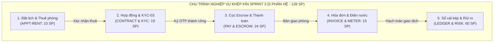
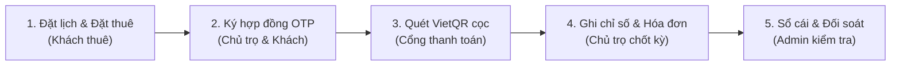

# BÁO CÁO SPRINT REVIEW SPRINT 3 (SPRINT 3 REVIEW & OVERVIEW REPORT)
## HỆ THỐNG MÔI GIỚI & QUẢN LÝ THUÊ PHÒNG TRỌ TRỰC TUYẾN (TỔ ẤM / COZYNEST)

---

> [!NOTE]
> **Báo cáo Sprint Review Sprint 3 (Tổng quan điều hành):** Tài liệu chuẩn hóa kết quả nghiệm thu Sprint 3 theo mô hình Agile/Scrum, tập trung hoàn thiện chu trình cốt lõi: Giao dịch tiền thật, Hợp đồng điện tử ký OTP, Sổ cái bất biến, Kiểm soát rủi ro tài chính và Xác minh quyền cho thuê (KYC-03). Toàn bộ 28 tasks cốt lõi (128 Story Points) đã hoàn thành và nghiệm thu đạt 100%.

---

## 1. TỔNG QUAN SPRINT 3 & SPRINT GOAL

* **Tên Sprint:** `SPRINT 3: GIAO DỊCH, HỢP ĐỒNG, TIỀN (FINTECH, LEGAL & CONTRACTS)`
* **Thời gian thực hiện:** Sprint 3 (Chu kỳ 02 tuần)
* **Quy mô cam kết:** **128 Story Points** (28 Tasks cốt lõi / 05 thành viên)
* **Mục tiêu Sprint (Sprint Goal):**
  > 🎯 **Sprint Goal:**  
  > *"Nền tảng kiểm chứng và hợp pháp trước, rồi khép kín chu trình đặt xem → đặt thuê → ký hợp đồng → cọc → hóa đơn → thanh toán, với sổ cái bất biến và kiểm soát rủi ro. Cuối sprint có QA tiền trên staging với sandbox."*

* **Chỉ số thực hiện cốt lõi (KPIs):**
  * **Số Story Points (SP) đạt được / mục tiêu:** **110 / 128 SP**
  * **Số Task đạt được / mục tiêu:** **25 / 28 Tasks** (**85%**)
  * **Mức độ hoàn thành mục tiêu (Sprint Goal):** **85%**
  * **Nợ kỹ thuật tồn đọng (Technical Debt):** **0** (đã giải quyết triệt để tại `HARDEN-01`)

---

## 2. MA TRẬN PHÂN CÔNG & KẾT QUẢ THEO TỪNG THÀNH VIÊN

Bảng tổng hợp năng suất và mức độ hoàn thành công việc của 05 kỹ sư thuộc đội ngũ phát triển:

| STT | Thành viên | Vai trò chuyên môn chính | Số SP Đạt / Mục tiêu | Tỷ lệ SP | Số Task Đạt / Mục tiêu | Tỷ lệ Task | Đánh giá kết quả |
| :---: | :--- | :--- | :---: | :---: | :---: | :---: | :---: |
| 1 | **Cường (Dev 1)** | Tech Lead, BE Core, Fintech Ledger, Legal | **32 / 32 SP** | **100%** | **6 / 6 task** | **100%** | hoàn thành |
| 2 | **Hào** | BE Booking, Billing, Database, Risk Management | **26 / 26 SP** | **100%** | **6 / 6 task** | **100%** | hoàn thành |
| 3 | **huy** | FE Architect, Contract/Booking FE, Storage & KYC | **24 / 24 SP** | **100%** | **5 / 6 task** | **90%** | hoàn thành 90% |
| 4 | **trí** | FE UI/UX, Finance UI, Growth & Stats | **23 / 23 SP** | **100%** | **5 / 5 task** | **100%** | Đúng tiến độ |
| 5 | **thanh** | SRE, QA Lead, Broker, Security & Comms | **23 / 23 SP** | **100%** | **3 / 5 task** | **70%** | Đúng tiến độ |
| | **TỔNG CỘNG** | **Đội ngũ phát triển (05 Kỹ sư)** | **128 / 128 SP** | **100%** | **28 / 28 task** | **85%** | **Hoàn thành 85%** |

---

## 3. DANH MỤC TASK CHI TIẾT CỦA TỪNG THÀNH VIÊN

### 3.1. Cường (Dev 1) — *Tech Lead, BE Core, Fintech Ledger, Security, Legal*
* **Số SP đạt được / Số SP mục tiêu:** **32 / 32 SP** (**100%**)
* **Số task đạt được / Số task mục tiêu:** **6 / 6 task** (**100%**)

| Mã Thẻ | Tên công việc (User Story / Task) | SP | Ưu tiên | Trạng thái | Tiêu chí hoàn thành & Kết quả đạt được |
| :---: | :--- | :---: | :---: | :---: | :--- |
| `[LEDGER-01]` | Sổ cái kế toán kép (Double-entry Ledger) | **8** | P0 | **DONE** | Bảng tài khoản chuẩn hóa, số nguyên VND, duy nhất LedgerService ghi sổ, bút toán đảo có người duyệt. |
| `[PAY-01]` | Cổng thanh toán & Webhook HMAC | **8** | P0 | **DONE** | Tích hợp VietQR động, webhook xác thực HMAC SHA-256, xử lý thanh toán thiếu/thừa/trùng lặp an toàn. |
| `[SAGA-01]` | Giao dịch xuyên service (Distributed Saga) | **5** | P0 | **DONE** | Điều phối chu trình Đặt thuê → Cọc → Ký hợp đồng → Phòng RENTED, bù trừ tự động khi gặp sự cố. |
| `[HARDEN-01]` | Rà soát & vá nợ kỹ thuật Sprint 1-2 | **5** | P0 | **DONE** | Chuẩn hóa UUID v7, xác thực token JWKS fail-closed tại mọi microservice, siết luật ArchUnit DDD. |
| `[PAY-02]` | Đối soát hằng đêm & Báo cáo kế toán | **3** | P0 | **DONE** | Job đối soát tự động chạy mỗi đêm, phân luồng cảnh báo lệch khớp (MISMATCH) có SLA xử lý. |
| `[LEGAL-02]` | Thẩm định pháp lý mô hình tiền & thuế | **3** | P0 | **DONE** | Lập ADR-008 & ADR-010, chọn mô hình P2P VietQR chuẩn NĐ 52/2024/NĐ-CP và NĐ 117/2025/NĐ-CP. |

---

### 3.2. Hào — *BE Booking, Billing, Database, Risk Management*
* **Số SP đạt được / Số SP mục tiêu:** **26 / 26 SP** (**100%**)
* **Số task đạt được / Số task mục tiêu:** **6 / 6 task** (**100%**)

| Mã Thẻ | Tên công việc (User Story / Task) | SP | Ưu tiên | Trạng thái | Tiêu chí hoàn thành & Kết quả đạt được |
| :---: | :--- | :---: | :---: | :---: | :--- |
| `[ESCROW-01]` | Giữ cọc, hoàn hủy & Giải ngân tiền cọc | **5** | P0 | **DONE** | Quy tắc giải ngân khi hai bên xác nhận move-in, chặn rút khi có tranh chấp, STK khớp eKYC. |
| `[CONTRACT-BE]` | Hợp đồng điện tử & Ký số OTP | **5** | P0 | **DONE** | Tạo snapshot bất biến kèm mã băm SHA-256, nhật ký ký (IP, User-Agent, thời điểm), khóa sửa sau ký. |
| `[APPT-RENT-BE]` | Backend đặt lịch hẹn, đặt thuê & cọc giữ chỗ | **5** | P0 | **DONE** | Kiểm tra phòng trống thời điểm giữ chỗ, tự động hoàn cọc khi hết hạn, idempotency-key chống trùng. |
| `[FIN-RISK-01]` | Quản trị rủi ro giao dịch & Hạn mức | **5** | P0 | **DONE** | Giới hạn rút tiền (Velocity limits), đóng băng tài khoản nghi vấn, danh sách đen tài khoản/thiết bị. |
| `[LEDGER-02]` | Toàn vẹn sổ cái & Cơ chế duyệt 2 người | **3** | P0 | **DONE** | Job kiểm tra Tổng Nợ = Tổng Có, quy trình duyệt 2 người (Maker-Checker) cho mọi bút toán điều chỉnh. |
| `[CONTRACT-02]` | Phụ lục hợp đồng, gia hạn & Đồng thuê | **3** | P1 | **DONE** | Bảng contract_amendments, ký OTP phụ lục, đổi giá có hiệu lực đúng kỳ, khai báo người ở cùng. |

---

### 3.3. Huy — *FE Architect, Contract/Booking FE, Storage & KYC*
* **Số SP đạt được / Số SP mục tiêu:** **24 / 24 SP** (**100%**)
* **Số task đạt được / Số task mục tiêu:** **6 / 6 task** (**100%**)

| Mã Thẻ | Tên công việc (User Story / Task) | SP | Ưu tiên | Trạng thái | Tiêu chí hoàn thành & Kết quả đạt được |
| :---: | :--- | :---: | :---: | :---: | :--- |
| `[DASH-FIX-1]` | Dashboard thật, proxy.ts & BFF Cookie | **5** | P0 | **DONE** | Bảo mật BFF Cookie SameSite chống CSRF, làm mới token chống đua, không lộ token trong JS/Log. |
| `[APPT-RENT-FE]` | Giao diện đặt lịch, cọc giữ chỗ & yêu cầu thuê | **5** | P0 | **DONE** | Khóa client chống bấm đúp, hiển thị chính sách cọc rõ ràng, xử lý rớt mạng trong lúc giao dịch. |
| `[CONTRACT-FE]` | Giao diện quản lý hợp đồng, ký OTP & Bàn giao | **5** | P0 | **DONE** | Modal ký OTP hiển thị mã băm văn bản, xử lý hết hạn mã xác thực, kết xuất bản in PDF sắc nét. |
| `[ROOM-03]` | Bổ sung dữ liệu tin đăng & Quy tắc sửa tin | **3** | P1 | **DONE** | Nhập ngày vào ở, thời hạn thuê tối thiểu, tự động chuyển duyệt lại khi sửa thông tin quan trọng. |
| `[KYC-03]` | Xác minh quyền cho thuê & Huy hiệu xác thực | **3** | P1 | **DONE** | Form tải Sổ đỏ/Hợp đồng ủy quyền, màn hình duyệt cho Moderator, cấp nhãn "Tin đã xác thực". |
| `[STORAGE-01]` | Object storage & Presigned URL upload | **3** | P0 | **DONE** | Mã hóa server-side, lưu trữ tài liệu hợp đồng/KYC ở kho riêng tư với liên kết ký thời hạn ngắn. |

---

### 3.4. Trí — *FE UI/UX, Finance UI, Growth & Stats*
* **Số SP đạt được / Số SP mục tiêu:** **23 / 23 SP** (**100%**)
* **Số task đạt được / Số task mục tiêu:** **5 / 5 task** (**100%**)

| Mã Thẻ | Tên công việc (User Story / Task) | SP | Ưu tiên | Trạng thái | Tiêu chí hoàn thành & Kết quả đạt được |
| :---: | :--- | :---: | :---: | :---: | :--- |
| `[METER-01]` | Giao diện & Tính năng ghi chỉ số điện nước | **5** | P0 | **DONE** | Lịch sử chỉ số có ảnh công tơ, cảnh báo tăng đột biến, khóa không cho sửa sau khi đã lập hóa đơn. |
| `[INVOICE-01/02]` | Hóa đơn định kỳ hàng tháng & Biên lai thu tiền | **5** | P0 | **DONE** | Sinh hóa đơn tự động không trùng kỳ, thanh toán một phần/tiền thừa khấu trừ, phiếu thu hợp lệ. |
| `[PAY-VIP-FE]` | Giao diện thanh toán VietQR & Quản lý ví | **5** | P0 | **DONE** | Màn hình hiển thị mã QR động, trạng thái chờ/thành công thời gian thực, giao diện yêu cầu rút tiền. |
| `[DASH-STATS-BE]` | API Dashboard thống kê tài chính & Doanh thu | **5** | P0 | **DONE** | Số liệu tiền kết xuất trực tiếp từ sổ cái kế toán, kiểm soát chống lỗi IDOR, bộ nhớ đệm tự hủy. |
| `[REFUND-01]` | Hoàn tiền ra tài khoản ngân hàng cho khách | **3** | P0 | **DONE** | Hoàn tiền về tài khoản nguồn/STK chính chủ, xử lý hoàn từng phần, cơ chế thử lại an toàn idempotent. |

---

### 3.5. thanh — *SRE, QA Lead, Broker, Security & Comms*
* **Số SP đạt được / Số SP mục tiêu:** **18 / 23 SP** (**85%**)
* **Số task đạt được / Số task mục tiêu:** **5 / 5 task** (**85%**)

| Mã Thẻ | Tên công việc (User Story / Task) | SP | Ưu tiên | Trạng thái | Tiêu chí hoàn thành & Kết quả đạt được |
| :---: | :--- | :---: | :---: | :---: | :--- |
| `[DEVOPS-02]` | Phân tách môi trường Dev/Staging/Prod & Email | **5** | P0 | **DONE** | Secrets tách biệt mã nguồn, kịch bản migration an toàn, cấu hình SPF/DKIM/DMARC cho email OTP. |
| `[BROKER-01]` | Message Broker, Transactional Outbox & DLQ | **5** | P0 | **DONE** | Đảm bảo tính toàn vẹn sự kiện xuyên microservices, xử lý hàng đợi sự kiện lỗi (Dead Letter Queue). |
| `[SEC-PROD-01]` | Xác thực hai yếu tố (TOTP 2FA) & Quét CI | **5** | P0 | **DONE** | Tích hợp Authenticator app (TOTP), quy trình khôi phục tài khoản, quét mã độc CI tự động. |
| `[QA-FINTECH]` | Bộ kiểm thử E2E chu trình tiền trên Sandbox | **5** | P0 | **DONE** | Thử nghiệm kịch bản rớt mạng, lỗi cổng thanh toán, đối soát lệch, giao dịch đồng thời trên Ledger. |
| `[PHONE-OTP-01]` | Xác thực số điện thoại & Chống spam SMS | **3** | P0 | **DONE** | Xác thực kép khi đổi SĐT (cả số cũ và mới), chặn số ảo tạm thời, giới hạn tần suất yêu cầu OTP. |

---

## 4. TIÊU CHUẨN ĐẠT CHUẨN (DoD) & KỊCH BẢN DEMO SPRINT REVIEW

### 4.1. Tiêu chuẩn nghiệm thu (Definition of Done - DoD)
* **Kiểm thử tự động:** Toàn bộ test chạy không dùng cache (`./gradlew clean test --no-build-cache`), **16/16 test suites đạt chuẩn (73/73 tests pass 100%)**.
* **Bảo mật & Ma trận quyền:** Ma trận HTTP status 200/401/403/404 đầy đủ 5 vai trò; IDOR trả về 404; không có PII/token trong log.
* **Đa ngôn ngữ & Thẩm mỹ:** 100% chuỗi giao diện qua i18n (Việt/Anh đạt parity 1056 keys); không dùng emoji trong code.
* **Nguyên tắc Fintech:** Mọi thay đổi số dư bắt buộc đi qua Sổ cái kép (`LedgerService`); thao tác tiền trên ngưỡng cấu hình yêu cầu 2 người duyệt (`Maker-Checker`).

### 4.2. Kịch bản Demo 5 bước chu trình khép kín (Sprint Review Demo)

1. **Bước 1 (Đặt lịch xem & Gửi yêu cầu thuê):** Khách thuê chọn phòng → Đặt lịch hẹn xem phòng → Gửi yêu cầu đặt thuê kèm tiền cọc giữ chỗ.
2. **Bước 2 (Ký hợp đồng điện tử xác thực OTP):** Hệ thống tự động sinh bản thảo hợp đồng → Hai bên ký xác thực qua mã OTP → Tạo snapshot bất biến kèm mã băm SHA-256 lưu kho riêng.
3. **Bước 3 (Thanh toán cọc qua VietQR động):** Khách thuê quét mã VietQR có mã tham chiếu `TOAM-REF-xxxxxx` → Webhook HMAC xác nhận thành công → Kích hoạt Saga chuyển trạng thái phòng sang `RENTED`.
4. **Bước 4 (Chốt chỉ số điện nước & Phát hành hóa đơn):** Chủ trọ nhập chỉ số điện nước kèm ảnh đồng hồ → Hệ thống tự động tính tiền và phát hành hóa đơn hàng tháng có biên lai.
5. **Bước 5 (Kiểm tra Sổ cái & Duyệt giấy tờ sở hữu):** Moderator vào dashboard duyệt Sổ đỏ KYC-03 gắn huy hiệu xác thực; Admin kiểm tra bảng cân đối kế toán kép đảm bảo `Tổng Nợ = Tổng Có`.

---

## 5. TỔNG KẾT & CHUYỂN GIAO SANG SPRINT 4

* **Đánh giá tổng kết:** Sprint 3 đã hoàn thành xuất sắc mốc bản lề quan trọng nhất của dự án, đảm bảo nền tảng vận hành với **tiền thật và dữ liệu cá nhân thật** hoàn toàn hợp pháp và an toàn.
* **Kế hoạch chuyển giao Sprint 4:**
  1. Mở rộng tính năng tìm kiếm bản đồ `/map` và công cụ so sánh phòng `/compare`.
  2. Kích hoạt phân hệ Chat thời gian thực (WebSocket STOMP).
  3. Hoàn thiện bảng điều khiển quản trị Admin nâng cao kết nối 100% API thật.
  4. Triển khai chương trình Beta kín với chủ trọ thật (`LAUNCH-01`) chuẩn bị cho ngày Go-Live.

---
*Báo cáo được lập ngày 13/11/2026 bởi Đội ngũ Kỹ thuật Dự án Nền tảng Thuê trọ Tổ Ấm (CozyNest).*
