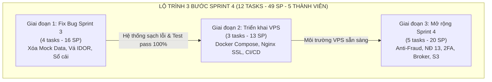
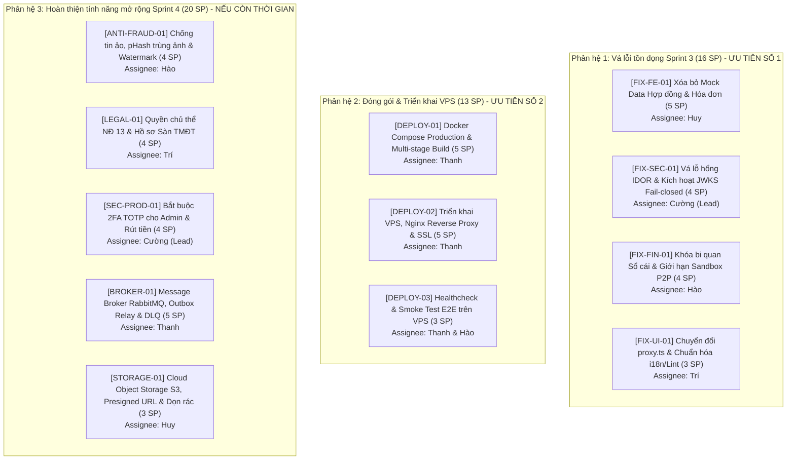
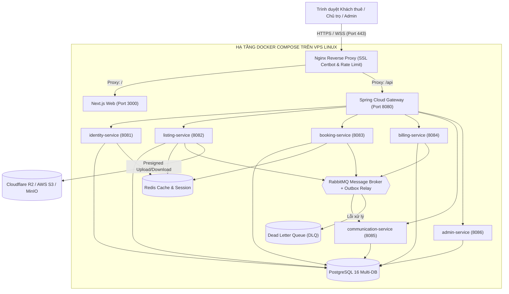
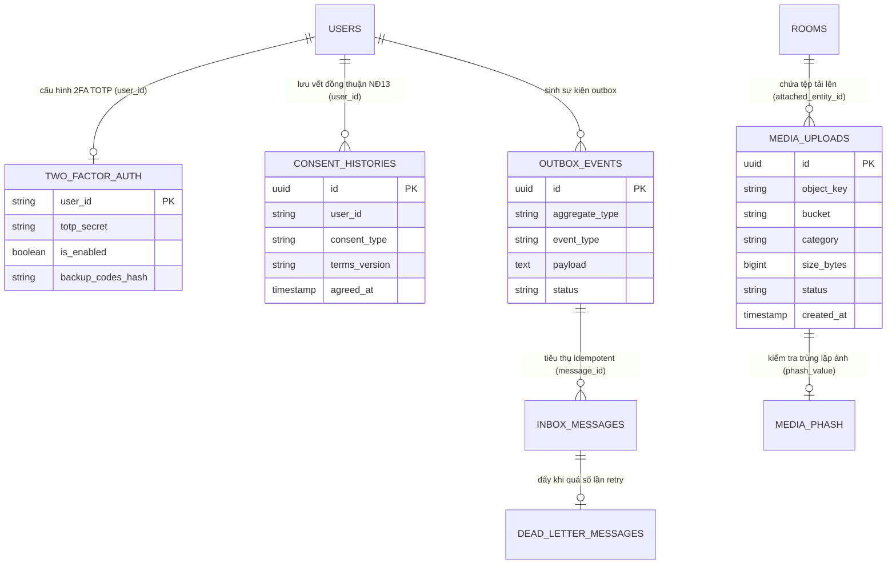
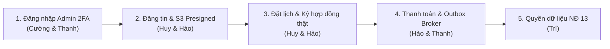

# KẾ HOẠCH PHÁT TRIỂN SPRINT 4 (SPRINT 4 PLANNING & OVERVIEW REPORT)
## HỆ THỐNG MÔI GIỚI & QUẢN LÝ THUÊ PHÒNG TRỌ TRỰC TUYẾN (COZYNEST / TỔ ẤM)

---

> [!NOTE]
> **Báo cáo Kế hoạch Sprint 4 (Tổng quan điều hành):** Tài liệu chuẩn hóa kế hoạch Sprint 4 theo mô hình Agile/Scrum dựa trên sự thống nhất của toàn đội ngũ phát triển (05 thành viên). Sprint 4 áp dụng **Chiến lược 3 Giai đoạn (3-Phased Strategy)**: Ưu tiên số 1 là khắc phục triệt để các lỗi và nợ kỹ thuật tồn đọng của Sprint 3; sau khi hệ thống đạt độ ổn định 100% sẽ đóng gói và triển khai toàn bộ lên máy chủ VPS; thời gian còn lại sẽ hoàn thiện các tính năng mở rộng nâng cao đã định sẵn của Sprint 4.

---

## 1. TỔNG QUAN SPRINT 4 & SPRINT GOAL

* **Tên Sprint:** `SPRINT 4: ỔN ĐỊNH TOÀN DIỆN (BUG FIXING S3), TRIỂN KHAI VPS (DEVOPS GO-LIVE) & TÍNH NĂNG MỞ RỘNG`
* **Thời gian thực hiện:** Sprint 4 (Chu kỳ 02 tuần / 10 ngày làm việc thực tế)
* **Quy mô cam kết:** **49 Story Points** (12 Tasks / 05 thành viên)
* **Chiến lược phân bổ nguồn lực (3 Trọng tâm cốt lõi):**
  1. **Giai đoạn 1 (P0 - Bắt buộc):** Khắc phục toàn bộ Bug & Nợ kỹ thuật tồn đọng từ Sprint 3 (xóa mock data, siết bảo mật IDOR, chuẩn hóa BFF Cookie).
  2. **Giai đoạn 2 (P0 - Mốc Go-Live):** Đóng gói Docker, cấu hình hạ tầng mạng Nginx SSL và triển khai toàn bộ hệ thống lên máy chủ VPS thực tế.
  3. **Giai đoạn 3 (P1 - Mở rộng tính năng Sprint 4):** Hoàn thiện các phân hệ mở rộng theo kế hoạch (Chống tin ảo/Watermark, Pháp lý Nghị định 13, Bảo mật 2FA TOTP, Message Broker thật và Cloud Object Storage).
* **Mục tiêu Sprint (Sprint Goal):**
  > 🎯 **Sprint Goal:**  
  > *"Xử lý dứt điểm 100% lỗi tồn đọng của Sprint 3 (nối API thật cho toàn bộ màn hình Hợp đồng & Hóa đơn, vá lỗ hổng IDOR/JWKS), đưa toàn bộ nền tảng microservices và frontend lên vận hành ổn định trên máy chủ VPS có chứng chỉ SSL/Domain thật; đồng thời kích hoạt các chốt chặn an toàn về Chống lừa đảo (Anti-Fraud), Tuân thủ pháp lý (Nghị định 13), 2FA TOTP, Message Broker tin cậy (RabbitMQ) và Lưu trữ đám mây (S3/R2)."*

---

## 2. PHÂN RÃ CÁC MODULE & DANH MỤC TASK CHI TIẾT

Sprint 4 được cấu trúc thành **3 Phân hệ chiến lược** với tổng cộng **12 tasks** chi tiết:

### Bảng tổng hợp chi tiết công việc theo từng Phân hệ

| Phân hệ / Giai đoạn | Mã Task | Tên công việc (User Story / Task) | SP | Ưu tiên | Người phụ trách | Mô tả tóm tắt & Tiêu chí hoàn thành chính (Acceptance Criteria) |
| :--- | :---: | :--- | :---: | :---: | :---: | :--- |
| **Phân hệ 1: Vá lỗi tồn đọng Sprint 3** *(16 SP)* | `[FIX-FE-01]` | Xóa bỏ Mock Data, nối API thật cho luồng Hợp đồng, Hóa đơn & Ví cọc | **5** | **P0** | **Huy** | Thay thế 100% mock data mảng tĩnh và `setTimeout` tại `tenant/contracts`, `landlord/contracts`, `tenant/invoices`, `tenant/payments`, `landlord/utilities` bằng `HttpContractRepository`, `HttpInvoiceRepository` thật. |
| | `[FIX-SEC-01]` | Vá lỗ hổng IDOR, gắn quyền `@PreAuthorize` và kích hoạt `JwksTokenValidator` | **4** | **P0** | **Cường** | Bổ sung kiểm tra quyền sở hữu tài nguyên ở `billing-service` và `admin-service`; đấu nối `JwksTokenValidator` fail-closed vào `JwtAuthFilter` của 5 microservices, ngăn chặn leo thang đặc quyền. |
| | `[FIX-FIN-01]` | Củng cố Sổ cái kế toán, khóa bi quan giao dịch và cô lập Sandbox P2P | **4** | **P0** | **Hào** | Bổ sung `SELECT ... FOR UPDATE` tránh xung đột đồng thời khi ghi nhận thanh toán; cấu hình cờ tính năng `fintech.mode=SANDBOX_ONLY` ngăn giữ ví tiền mặt trái phép theo khuyến cáo `LEGAL-02`. |
| | `[FIX-UI-01]` | Chuyển đổi `middleware.ts` sang `proxy.ts`, xử lý cảnh báo Lint & khớp i18n | **3** | **P0** | **Trí** | Nâng cấp file điều phối Next.js 16 sang `src/proxy.ts`, sử dụng HttpOnly Cookie cho BFF authentication; dọn dẹp các cảnh báo eslint `i18next/no-literal-string`, đảm bảo 100% parity đa ngôn ngữ. |
| **Phân hệ 2: Đóng gói & Triển khai VPS** *(13 SP)* | `[DEPLOY-01]` | Chuẩn hóa Dockerfile Multi-stage build & Docker Compose Production | **5** | **P0** | **Thanh** | Tối ưu kích thước image Backend Java (Temurin Alpine JRE) và Frontend Next.js (Standalone output); viết `docker-compose.prod.yml` gồm cấu hình tài nguyên (CPU/RAM limits), mạng nội bộ và volume dữ liệu. |
| | `[DEPLOY-02]` | Thiết lập máy chủ VPS, Nginx Reverse Proxy, Tường lửa UFW & SSL Let's Encrypt | **5** | **P0** | **Thanh** | Cấu hình máy chủ Linux VPS, mở cổng an toàn qua UFW; cài đặt Nginx Reverse Proxy định tuyến `/api` vào Gateway và `/` vào Frontend; tự động gia hạn chứng chỉ SSL với Certbot; gắn tên miền chính thức. |
| | `[DEPLOY-03]` | Kiểm thử tải nhẹ, Smoke Test E2E và thiết lập Healthcheck giám sát | **3** | **P0** | **Thanh & Hào** | Kiểm tra endpoint `/actuator/health` của từng service trên VPS; thực hiện kịch bản E2E Smoke test (Đăng ký → Đăng tin → Đặt lịch → Ký hợp đồng) đảm bảo không lỗi kết nối mạng nội bộ trên VPS. |
| **Phân hệ 3: Mở rộng tính năng Sprint 4** *(20 SP) *(Nếu còn thời gian)* | `[ANTI-FRAUD-01]` | Hệ thống chống tin ảo, lọc giá câu khách, Watermark ảnh mờ & Trust Score | **4** | **P1** | **Hào** | Phát hiện giá lệch > 40% so với trung vị phường; kiểm tra SĐT/Zalo né sàn; tính perceptual hash (pHash) chặn trùng lặp ảnh phòng; đóng dấu mờ ("Tổ Ấm - mã tin"); tính Trust Score cho chủ trọ. |
| | `[LEGAL-01]` | Tuân thủ pháp lý Việt Nam (Nghị định 13/2023/NĐ-CP & Hồ sơ Sàn TMĐT) | **4** | **P1** | **Trí** | Cung cấp tính năng Export gói dữ liệu cá nhân (JSON) & Ẩn danh hóa tài khoản (giữ lại số liệu kế toán theo luật thuế); bảng `consent_histories` lưu vết đồng thuận; trang quy chế giải quyết tranh chấp ở Footer. |
| | `[SEC-PROD-01]` | Bắt buộc 2FA TOTP cho Admin & Rút tiền, bảo mật KMS/Vault và quét CI | **4** | **P1** | **Cường** | Bắt buộc mã OTP ứng dụng (Google Authenticator) khi Admin đăng nhập hoặc Chủ trọ đổi STK ngân hàng / rút tiền (trả 403 nếu thiếu); tích hợp cơ chế nạp secret từ Vault; gắn Trivy/OWASP scan vào CI. |
| | `[BROKER-01]` | Message Broker thật (RabbitMQ) + Outbox Relay & Dead Letter Queue (DLQ) | **5** | **P1** | **Thanh** | Cấu hình RabbitMQ topology; xây dựng Transactional Outbox Relay; Idempotent Consumer qua `inbox_messages`; hàng đợi thư chết DLQ và API replay message lỗi cho DevOps/Admin. |
| | `[STORAGE-01]` | Cloud Object Storage (S3 / R2), Presigned Upload & Dọn dẹp File mồ côi | **3** | **P1** | **Huy** | Thiết kế `ObjectStoragePort` tách Public Bucket (CDN) & Private Encrypted Bucket (KYC/Hợp đồng); cấp SigV4 Presigned URL; kiểm tra magic bytes & chuyển WebP; Cron scheduler dọn file mồ côi quá 24h. |
| **TỔNG CỘNG** | **12 Tasks** | **Chiến lược: Vá Bug S3 (16 SP) → Triển khai VPS (13 SP) → Mở rộng (20 SP)** | **49** | | **05 Thành viên** | **100% Khối lượng Sprint 4 cam kết** |

---

## 3. MA TRẬN PHÂN CÔNG CÔNG VIỆC THEO THÀNH VIÊN

Bảng phân bổ khối lượng công việc cân bằng cho 05 kỹ sư thuộc đội ngũ phát triển:

| STT | Thành viên | Vai trò chuyên môn | Phân hệ đảm nhiệm chính | Các Task được phân công | Tổng Story Points | Tỷ lệ đóng góp |
| :---: | :--- | :---: | :--- | :--- | :---: | :---: |
| 1 | **Cường (Dev 1)** | **Tech Lead / BE Core** | **Phân hệ 1 & 3:** An ninh hệ thống, Sổ cái & 2FA TOTP | `[FIX-SEC-01]` (4 SP) `[SEC-PROD-01]` (4 SP) | **8 SP** | 16.3% |
| 2 | **Hào** | **BE Core / Risk** | **Phân hệ 1, 2 & 3:** Sổ cái kép, Smoke Test & Chống tin ảo | `[FIX-FIN-01]` (4 SP) `[DEPLOY-03]` (1.5 SP) `[ANTI-FRAUD-01]` (4 SP) | **9.5 SP** | 19.4% |
| 3 | **Huy** | **FE Architect / Storage** | **Phân hệ 1 & 3:** Xóa Mock Data, Nối API & Object Storage | `[FIX-FE-01]` (5 SP) `[STORAGE-01]` (3 SP) | **8 SP** | 16.3% |
| 4 | **Trí** | **FE Specialist / Legal** | **Phân hệ 1 & 3:** Chuẩn hóa UI/i18n & Pháp lý Nghị định 13 | `[FIX-UI-01]` (3 SP) `[LEGAL-01]` (4 SP) | **7 SP** | 14.3% |
| 5 | **Thanh** | **DevOps / SRE / QA Lead** | **Phân hệ 2 & 3:** Đóng gói VPS, SSL Nginx & Message Broker | `[DEPLOY-01]` (5 SP) `[DEPLOY-02]` (5 SP) `[DEPLOY-03]` (1.5 SP) `[BROKER-01]` (5 SP) | **16.5 SP** | 33.7% |
| | **TỔNG CỘNG** | **05 Kỹ sư** | **03 Trọng tâm chiến lược** | **12 Tasks cam kết** | **49 SP** | **100%** |

---

## 4. SƠ ĐỒ THỰC THỂ LIÊN KẾT (ERD) & KIẾN TRÚC HẠ TẦNG SPRINT 4

### 4.1. Kiến trúc triển khai hạ tầng Production trên máy chủ VPS

### 4.2. Sơ đồ dữ liệu quan hệ mới bổ sung trong Sprint 4 (ERD)

---

## 5. TIÊU CHUẨN HOÀN THÀNH (DoD) & KỊCH BẢN NGHIỆM THU VPS (SPRINT REVIEW)

### 5.1. Tiêu chuẩn nghiệm thu định lượng (Definition of Done - DoD)
* **Chất lượng Code & Vá lỗi:**
  * 100% màn hình FE không còn sử dụng mock array tĩnh và không giả lập `setTimeout`.
  * Không còn cảnh báo lỗi IDOR ở `billing-service` và `admin-service`; `@PreAuthorize` hoạt động nghiêm ngặt theo đúng vai trò.
  * Toàn bộ test suite Backend pass 100% (`./gradlew test` đạt chuẩn kiến trúc Hexagonal ArchUnit).
  * Frontend pass 100% kiểm tra liên kết nội bộ (`verify:links`), đa ngôn ngữ (`verify:i18n`) và bộ ảnh bản quyền (`verify:manifest`).
* **Hạ tầng VPS & Go-Live:**
  * Máy chủ VPS truy cập mượt mà qua HTTPS với chứng chỉ SSL hợp lệ (A rating trên SSL Labs).
  * Toàn bộ các container Docker trong `docker-compose.prod.yml` ở trạng thái `healthy`, tự khởi động lại khi có sự cố (`restart: unless-stopped`).
  * Tách biệt an toàn giữa các biến môi trường Production (`.env`) và mã nguồn Git (không commit secret lên repository).

### 5.2. Kịch bản nghiệm thu 5 bước thực tế trên máy chủ VPS (Sprint Review Demo)

1. **Bước 1 (Xác thực đặc quyền 2FA trên VPS):** Mở trình duyệt truy cập tên miền VPS → Đăng nhập tài khoản Admin/Moderator → Hệ thống yêu cầu mã TOTP 6 số từ Google Authenticator → Nhập đúng mã mới được vào Dashboard (chặn 403 nếu sai hoặc thiếu).
2. **Bước 2 (Kiểm tra Đăng tin, Chống tin ảo & Upload S3):** Chủ trọ đăng phòng mới → Thử nhập giá quá thấp (< 40% trung vị phường) hệ thống cảnh báo gắn cờ HIGH_RISK → Tải ảnh phòng qua Presigned URL trực tiếp lên Object Storage → Ảnh công khai hiển thị watermark mờ chính chủ và tự tối ưu WebP.
3. **Bước 3 (Kiểm tra luồng Hợp đồng không Mock Data):** Khách thuê chọn phòng và gửi yêu cầu thuê → Chủ trọ duyệt → Cả hai bên ký hợp đồng điện tử qua OTP thật → Dữ liệu tải từ DB qua API thật, xuất file PDF hợp đồng có chữ ký số và mã băm SHA-256.
4. **Bước 4 (Thanh toán, Outbox Relay & Xử lý sự kiện):** Khách thanh toán hóa đơn cọc qua VietQR động → Hệ thống ghi nhận Sổ cái kép an toàn → Event được Outbox Relay gửi lên RabbitMQ thật → Service gửi thông báo nhận tin tức thời, không bị nghẽn hay mất gói tin.
5. **Bước 5 (Kiểm tra Tuân thủ Nghị định 13 & Dọn dẹp dữ liệu):** Vào trang Cài đặt bảo mật cá nhân → Nhấn "Yêu cầu tải toàn bộ dữ liệu cá nhân" → Tải file JSON chứa dữ liệu hoạt động → Kiểm tra chân trang hiển thị đầy đủ quy chế sàn TMĐT, chính sách bảo vệ dữ liệu và giải quyết tranh chấp.
