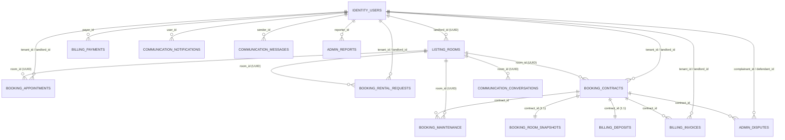

# Sơ Đồ Quan Hệ Tổng Quan Giữa Các Microservices (Cross-Service ERD)
**Dự án:** Nền tảng Thuê trọ "Tổ Ấm"  
**Quy tắc:** Bounded Context độc lập, không dùng Foreign Key vật lý liên schema; mọi quan hệ liên service hoàn toàn thông qua UUID tham chiếu có đánh Index.

